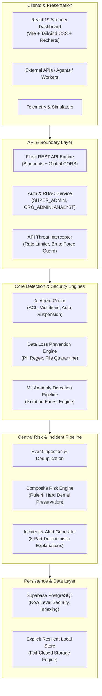

# AI-SHIELD — Architecture & System Design

## 1. System Overview

AI-SHIELD is a unified cybersecurity monitoring and data loss prevention platform engineered specifically for small and medium enterprises (SMEs). It protects organizations from unauthorized AI-agent actions, internal data leaks, abnormal employee behavior, and suspicious API activity.

The system enforces a strict defense-in-depth model where deterministic rule-based policies and machine learning anomaly detection collaborate through a central risk engine.

---

## 2. Component Architecture

### A. Presentation Layer (Frontend)
- **Framework:** React 19 with TypeScript and Vite.
- **Styling:** Tailwind CSS with an enterprise cybersecurity dark theme.
- **Icons & Data Visualization:** Lucide React and Recharts.
- **Views (10 Sections):**
  1. **Overview:** System threat posture, event throughput, active vs suspended agents, risk distribution.
  2. **Incidents:** Incident backlog, severity filters, administrator assignment, status transitions, explainability drawer.
  3. **Activity Monitoring:** Live event telemetry feed, search, actor filters.
  4. **Files & Sharing:** Data transfer activity, external sharing detections.
  5. **API Monitor:** Client IPs, rate limit statuses, suspicious access patterns.
  6. **DLP Violations:** Matched PII patterns, quarantine file management, policy actions.
  7. **Risk & Recommendations:** Multi-factor score breakdown and suggested remediations.
  8. **AI Agent Management:** Agent registry, permission matrices, auto-suspension thresholds, manual override.
  9. **Security Policies:** Active DLP and ACL policy configurations.
  10. **System Settings:** Health checks, database connectivity, ML model metadata, simulator controls.

### B. API & Boundary Layer (Backend)
- **Framework:** Python 3.14 / Flask 3.1.
- **Design Pattern:** Application Factory (`create_app`) with modular Blueprints.
- **Authentication & RBAC:**
  - Token-based authentication with role hierarchies: `SUPER_ADMIN`, `ORGANIZATION_ADMIN`, `SECURITY_ANALYST`, `EMPLOYEE`.
  - Fail-closed route decorators (`@require_auth`, `@require_role`).
- **API Threat Detection:** In-memory sliding-window counter tracking client IPs, request frequency, brute-force login attempts, and unauthorized probing.

### C. Core Security Modules
- **AI Agent Guard (`security/agent_guard.py`):**
  - Manages AI agent identity, permissions, allowed resources, allowed actions, and destinations.
  - Denies unauthorized access by default.
  - Automatically suspends agents exceeding configurable violation thresholds (default: 3 violations).
  - Persists violation records and suspension history.
- **Data Loss Prevention Engine (`security/dlp_engine.py`):**
  - Identifies sensitive identifiers (Email, Credit Card/PAN, Aadhaar, API Keys, Passwords, Confidential document headers).
  - Validates transfer destinations (Internal vs External/Personal).
  - Handles quarantined files securely with path traversal protection.
- **Machine Learning Engine (`ml/`):**
  - Feature extraction converting raw event telemetry into numerical behavioral vectors.
  - Trained Scikit-learn `IsolationForest` model for statistical anomaly detection.
  - Evaluated on precision, recall, F1, and ROC-AUC.
  - Enforces Contract Rule 4: ML scores cannot downgrade hard security denials.

### D. Pipeline & Central Risk Engine
- **Event Orchestrator (`backend/pipeline/event_processor.py`):** Coordinates validation, deduplication, rule evaluation, ML scoring, risk computation, database persistence, and incident dispatching.
- **Composite Risk Calculation:**
  - Hard denials guarantee a minimum score of `85.0` and a `critical` severity.
  - Nominal events are weighted across security rule triggers (50%), ML anomalies (30%), and API threat indicators (20%).
  - Produces an 8-part deterministic explanation answering: What, Who, Resource, Suspicion, Rule, ML score, Risk, and Recommended Action.

---

## 3. Technology Stack

| Layer | Technologies |
|---|---|
| **Frontend** | React 19, TypeScript, Vite, Tailwind CSS, Recharts, Lucide React |
| **Backend** | Python 3.14, Flask 3.1, Supabase Python Client |
| **Machine Learning** | Scikit-learn 1.8.0, NumPy 2.4, Pandas 3.0, Joblib |
| **Database** | Supabase PostgreSQL, SQL Migrations (001 & 002), Row-Level Security |
| **Testing** | Pytest, Unittest, React Testing Library / Vitest |
