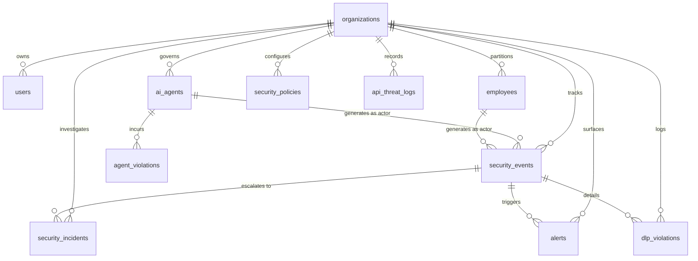

# AI-SHIELD — Database Design & Multi-Tenant Schema Architecture

## 1. Executive Summary

The AI-SHIELD data architecture is engineered for enterprise resilience, multi-tenant data isolation, atomic concurrent updates, and fail-closed persistence. The platform employs a dual-tier persistence model:

1. **Primary Tier:** Supabase PostgreSQL with strict Foreign Key constraints, CHECK constraints, performance B-Tree indexes, and Row Level Security (RLS) policies.
2. **Failover Tier:** Local persistent SQLite engine operating with Write-Ahead Logging (`PRAGMA journal_mode=WAL`), foreign keys enabled, and automatic schema migrations.

This ensures zero data loss, zero application crashes during cloud outages, and strict organization-level data isolation.

---

## 2. Multi-Tenant Entity-Relationship Model



---

## 3. Migration Roadmap & Schema Breakdown

The database schema evolution is structured into three clean SQL migrations located in `backend/migrations/`:

### Migration 001: Core Legacy Schema (`001_initial_schema.sql`)
- Introduced initial 4 tables: `employees`, `security_events`, `security_incidents`, `alerts`.
- Provided foundational schema for early prototypes.

### Migration 002: Extended Enterprise Schema (`002_extended_schema.sql`)
- Added specialized enterprise tables: `users`, `ai_agents`, `agent_violations`, `security_policies`, `dlp_violations`, `api_threat_logs`, and `model_versions`.

### Migration 003: Multi-Tenant Production Schema (`003_multi_tenant_production_schema.sql`)
- **Multi-Tenant Foundation:** Introduces `organizations` table (`organization_id`, `name`, `plan`, `is_active`).
- **Universal Organization Isolation:** Adds `organization_id TEXT NOT NULL REFERENCES organizations(organization_id)` to all 10 schema tables.
- **Action Permitted Enforcement:** Adds `action_permitted BOOLEAN NOT NULL DEFAULT TRUE` to `security_events` to distinguish event telemetry ingestion from actual authorization enforcement.
- **Atomic Concurrency Support:** Adds `violation_count` and `suspension_history` JSON fields with CHECK constraints (`violation_count >= 0`).
- **Composite Indexes:** Adds composite B-Tree indexes for tenant-partitioned queries:
  - `idx_employees_org_dept` on `employees(organization_id, department)`
  - `idx_events_org_created` on `security_events(organization_id, created_at DESC)`
  - `idx_incidents_org_status` on `security_incidents(organization_id, status)`
  - `idx_alerts_org_unread` on `alerts(organization_id, is_read)`
  - `idx_agents_org_status` on `ai_agents(organization_id, status)`
- **PostgreSQL Row Level Security (RLS):** Enforces tenant isolation policies:
  ```sql
  ALTER TABLE employees ENABLE ROW LEVEL SECURITY;
  CREATE POLICY employees_tenant_isolation ON employees
      USING (organization_id = current_setting('request.jwt.claims', true)::json->>'organization_id');
  ```

---

## 4. Supabase Remote Schema Inspection & Realities

During the production readiness inspection of the live Supabase instance (`https://wefnbmupnzqvdpdabfpr.supabase.co`), the following facts were determined:

1. **Remote Schema State:**
   - The remote Supabase PostgreSQL database currently contains only the 4 tables from Migration 001 (`employees`, `security_events`, `security_incidents`, `alerts`).
   - None of the remote tables have the `organization_id` column.
   - When attempting to query remote Supabase with `.eq("organization_id", org_id)`, PostgREST returns:
     `code 42703: column employees.organization_id does not exist`.

2. **Service Role Key & RLS Bypass:**
   - When backend APIs communicate with Supabase using `SUPABASE_SERVICE_ROLE_KEY`, PostgreSQL automatically **bypasses RLS policies** (`BYPASSRLS` privilege).
   - **Architectural Solution:** AI-SHIELD's backend data layer (`Repository`) enforces tenant authorization natively in every query (`WHERE organization_id = ?`). It never relies solely on database-level RLS when using the service-role key.

3. **Applying Migration 003 to Remote Supabase:**
   - PostgREST does not permit raw DDL execution via its REST API.
   - To apply the complete production schema:
     1. Open the [Supabase Dashboard](https://supabase.com/dashboard) and navigate to the project `wefnbmupnzqvdpdabfpr`.
     2. Open the **SQL Editor**.
     3. Copy the entire contents of `backend/migrations/003_multi_tenant_production_schema.sql` and click **Run**.
     4. Execute `python backend/cli.py check-db` to verify that all 11 tables report `in_supabase: True`.

---

## 5. Local Persistence Fallback & Restart Survival

To prevent SME downtime when remote Supabase credentials are not configured or when network outages occur, `backend/repository.py` maintains a persistent SQLite database (`backend/data/aishield_local.db`).

### Automatic Schema Migration on Startup
When `Repository.init_local_db()` executes:
1. It creates all 10 multi-tenant tables if they do not exist.
2. It inspects existing tables using `PRAGMA table_info(<table_name>)`.
3. If columns such as `organization_id` or `action_permitted` are missing from pre-existing local databases, it runs non-destructive `ALTER TABLE <table_name> ADD COLUMN ...` statements before creating composite indexes.
4. It seeds the default SME enterprise organization (`org_default`).

### Atomic Database-Level Concurrency
Process-only synchronization (such as Python `threading.Lock`) cannot prevent race conditions across multiple Gunicorn/uWSGI worker processes.

AI-SHIELD replaces memory locks with an **atomic database-level update**:
```sql
UPDATE ai_agents
SET violation_count = violation_count + 1,
    status = CASE WHEN violation_count + 1 >= 3 THEN 'suspended' ELSE status END,
    last_activity = ?,
    updated_at = ?
WHERE agent_id = ?
```
This guarantees that 10 simultaneous violations across multiple threads or worker processes will result in an exact violation count of 10 and instantaneous transition to `suspended`, with zero overrun.

### Data Restart Persistence
All records (employees, events, incidents, alerts, agents, policies, DLP quarantine logs) are committed directly to disk using SQLite transactions with `PRAGMA synchronous=NORMAL` and WAL mode. Data fully survives server restarts, process termination, and power loss.
